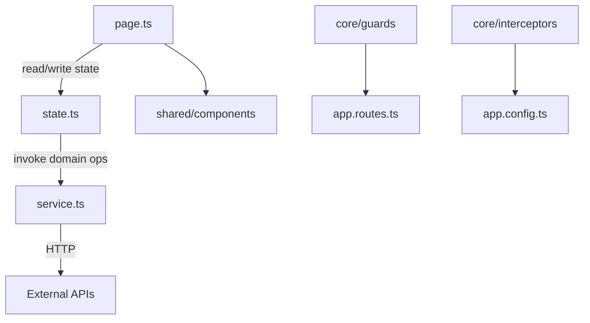

# Skill: Angular Architecture

Use when changing application structure, creating new page domains, or reviewing architectural consistency.

## Objectives

- Keep architecture deterministic and reviewable.
- Enforce standalone-first Angular organization.
- Enforce Signal Store as single state model (global + local). No NgRx.
- Keep one-way dependency flow: page -> state -> service -> http.
- Keep reusable code in `shared`, single-instance infra in `core`, feature logic in `pages`.

## 1) Architectural baseline (mandatory)

- Standalone components by default.
- Root routing file is `src/app/app.routes.ts`.
- Root wiring files:
  - `src/app/app.ts`
  - `src/app/app.config.ts`
  - `src/app/app.routes.ts`
- State model:
  - Signal Store in page domains (`state.ts`) for feature state.
  - Signal Store in `core/states` for global cross-page state.

## Reference detail

Detail for Repository layout (`src/`), App layer architecture (`src/app`), Naming and placement rules, Migration guidance (when refactoring legacy code): [references/architecture-patterns.md](references/architecture-patterns.md) — load when touching those areas.

## 2) Dependency and communication flow

Mandatory data/control flow:

1. `page.ts` consumes and mutates `state.ts`.
2. `state.ts` orchestrates feature logic and calls `service.ts`.
3. `service.ts` owns HTTP calls and transport mapping.
4. Child/presentational components receive state and callbacks via inputs/outputs/signals. They do not call HTTP directly.

## 3) Mandatory rules and anti-patterns

Do:

- Keep template expressions simple and side-effect free.
- Keep business rules in state/service, not view.
- Keep global state in `core/states` Signal Stores.
- Keep feature state in page-local `state.ts` Signal Stores.

Do not:

- Put business logic in templates.
- Trigger HTTP in components (`page.ts` or child components).
- Duplicate same state in multiple sibling components.
- Leave unmanaged manual `subscribe()` in components.
- Add NgRx artifacts (`actions`, `reducers`, `effects`, `selectors`).

## 4) Architecture review checklist

Before merge, confirm:

- [ ] `src/` layout follows adapter contract (`app`, `styles`, `styles.css`)
- [ ] `src/styles.css` imports Tailwind and all split CSS concern files
- [ ] page domains contain `page.ts`, `service.ts`, `state.ts`
- [ ] dependency flow is `page -> state -> service -> http`
- [ ] no direct HTTP calls in components
- [ ] Signal Store is used for both global and local state
- [ ] no NgRx files/patterns introduced
- [ ] reusable artifacts promoted to `shared` only when actually cross-page

## I/O Reference

|                |                                                                                            |
| -------------- | ------------------------------------------------------------------------------------------ |
| Trigger        | New app scaffold, architecture refactor, feature folder design, state boundary cleanup     |
| Reads          | `src/` tree, `src/app/` boundaries, `app.config.ts`, `app.routes.ts`, `styles.css` imports |
| Invoked by     | `devflow.plan`, `devflow.implement`, `devflow.beautify`                                    |
| Related skills | `angular-component`, `angular-forms`, `angular-http`, `angular-state`                      |
