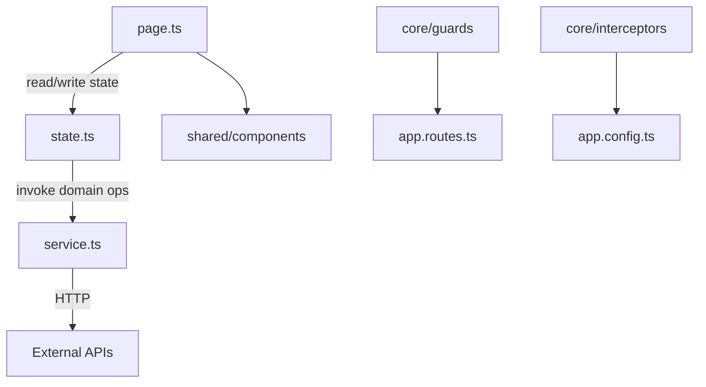

# Skill: Angular Architecture

## Purpose

Keep Angular app structure deterministic: `core` / `pages` / `shared` boundaries, one-way flow page → state → service → HTTP, Signal Store as the single state model.

## When NOT to Use

- File matches no row of `steps/implement.md` → skill load decision matrix (no barrel, boundary, root wiring or new feature folder touched).
- Inside one existing component/store/service with no boundary change → the matching technology skill.
- Generic code quality (naming, function size) → `common-clean-code`.

## 1) Architectural baseline (mandatory)

- Standalone components (v22 default — do not use `standalone: true`), signals-first.
- Root wiring: `src/app/app.ts`, `src/app/app.config.ts`, `src/app/app.routes.ts` (+ `app.config.server.ts`, `app.routes.server.ts` when SSR).
- State: NgRx Signal Store (`@ngrx/signals`) — page `state.ts` for feature state, `core/states` for cross-page state.

## 2) Dependency and communication flow

1. `page.ts` reads and mutates `state.ts`.
2. `state.ts` orchestrates feature logic and calls `service.ts`.
3. `service.ts` owns all HTTP — `HttpClient` calls and `httpResource()` fields — plus transport mapping.
4. Child/presentational components receive data via inputs and report via outputs. No HTTP, no service injection.

## 3) Mandatory rules and anti-patterns

Do:

- Keep template expressions simple and side-effect free; business rules in state/service.
- Global state in `core/states`; feature state in page-local `state.ts`.
- Promote to `shared/` only after reuse in a second page.

Do not:

- Put business logic in templates.
- Inject `HttpClient` or declare `httpResource()` in components (`page.ts` or children).
- Duplicate the same state in sibling components.
- Leave manual `subscribe()` in components without `takeUntilDestroyed`.
- Do not use `@ngrx/store` artifacts (`actions`, `reducers`, `effects`, `selectors`) — Signal Store only.

## Reference detail

Repository layout (`src/`), app layer tree, naming/placement, legacy migration: [references/architecture-patterns.md](references/architecture-patterns.md).

## 4) Architecture review checklist

- [ ] `src/` layout follows adapter contract (`app`, `styles`, `styles.css`)
- [ ] page domains contain `page.ts`, `service.ts`, `state.ts`
- [ ] dependency flow is `page -> state -> service -> http`
- [ ] no `HttpClient`/`httpResource()` in components
- [ ] Signal Store used for global and page state; `@ngrx/store` files never used
- [ ] reusable artifacts promoted to `shared` only when actually cross-page

## I/O Reference

|                |                                                                                            |
| -------------- | ------------------------------------------------------------------------------------------ |
| Trigger        | New app scaffold, architecture refactor, feature folder design, state boundary cleanup     |
| Reads          | `src/` tree, `src/app/` boundaries, `app.config.ts`, `app.routes.ts`, `styles.css` imports |
| Invoked by     | `devflow.plan`, `devflow.implement`, `devflow.beautify`                                    |
| Related skills | `angular-component`, `angular-forms`, `angular-http`, `angular-state`, `angular-theme`     |
