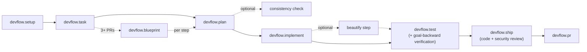

# DevFlow Architecture

How the plugin is put together and why. Companion to [`docs/comparison.md`](comparison.md) (positioning vs alternatives) and [`templates/devflow/README.md`](../templates/devflow/README.md) (component inventory).

## Design constraints

Three constraints shape everything below:

1. **Markdown + bash/jq only.** No runtime engine, no Node dependency. Skills are prompts an agent follows; hooks are POSIX-ish shell scripts. This keeps the plugin portable across hosts (Claude Code, Antigravity CLI) and auditable at a glance.
2. **User-gated by default.** Each pipeline step is a command the user invokes. Skills verify their own input contract and refuse to run on bad state; they do not invoke each other, with three exceptions: `devflow.implement` runs the optional beautify step when the user accepts it, `devflow.ship` routes to `devflow.pr` on gate pass, and the orchestrators `devflow.run` / `devflow.auto` chain steps on purpose.
3. **Adapters own stack truth.** Core skills are stack-agnostic; every stack-specific rule (commands, file layout, technology skills) lives in `adapters/<stack>/ADAPTER.md`.

## Pipeline



Cross-cutting entry points, outside the happy path:

| Command | When |
| --- | --- |
| `devflow.init` | Greenfield project bootstrap — multi-phase interview, live stack scaffolding, DevFlow context + `ADR-001` + `project-blueprint.md` + ordered `001..NNN` `task.md` roadmap |
| `devflow.discover` | Architectural trade-offs unresolved — compares 2–3 viable options and writes a formal ADR in `docs/adr/` |
| `devflow.run` / `devflow.auto` | Opt-in autonomy — `run` chains `implement → [beautify] → test` unattended; `auto` runs the full pipeline from raw idea to opened PR |
| `devflow.hotfix` | Urgent bugfix — compact task+plan → failing regression test → fix → full suite + verification → PR |
| `devflow.resume` | Session interrupted (restart, compaction, break), plan `blocked`, or state drifted — resyncs/unblocks (user-confirmed), re-enters correct step |
| `devflow.backprop` | Bug escaped the pipeline — traces it to the acceptance criterion, tightens the spec, adds a regression test |
| `devflow.worktree` | Isolated git worktrees with automatic port offset for parallel features |
| `devflow.status` / `devflow.doctor` | Read-only pipeline state snapshot (`status`) and environment/MCP/state pre-flight diagnostic (`doctor`) |
| `devflow.learn` | Persistent project instincts (log/search/check/prune/promote to `REGISTRY.md`) |
| `devflow.metrics` / `devflow.board` | Local telemetry dashboard (`metrics`) and static HTML Kanban + DAG project board (`board`) |

## Artifacts and state model

Every feature lives in `devflow/features/NNN_name/`:

| Artifact | Written by | Contains |
| --- | --- | --- |
| `task.md` | task | HMW framing, scope, subtasks, acceptance criteria |
| `plan.md` | plan (then updated by every step) | Architecture decisions, **Traceability table** (subtask → AC → files), ordered File List with `[done]`/`[pending]` markers, `**Status:**` |
| `data-model.md` | plan (conditional) | Technology-agnostic entity definitions |
| `verification.md` | test Step 6b | Per-AC verdict table (existence / substantive / wired / runtime) |

**`plan.md` is the authoritative state.** `.devflow-state.json` at the consumer root is a derived cache written by hooks and by skills at step boundaries. Statuses and legal transitions are defined once in [`references/state-machine.md`](../templates/devflow/references/state-machine.md):

```text
task.md: draft → done          (legacy `clarified` still read)
plan.md: ready → implementing → implemented → [beautified] → tested → shipped → pr-opened
         any active status → blocked (escalation ladder) → devflow.resume (user-confirmed reset)
```

Failure handling is a single bounded ladder ([`references/escalation-ladder.md`](../templates/devflow/references/escalation-ladder.md)): 3 retries → debug mode (max 2 hypotheses) → re-approach the plan → decompose the slice → block with a structured stuck-report.

## Quality gates

Forward-looking and goal-backward checks are deliberately separate:

- **plan consistency check** — optional Step 5b of `devflow.plan` (always on in `devflow.auto`): traceability, AC testability, terminology, constitution and ADR alignment, product fidelity. Read-only.

- **beautify** — optional step offered at implement exit (not a command): readability, conventions, design tokens, layout, a11y basics.
- **test** — adapter unit/integration targets, plus **goal-backward verification** ([`references/verification-levels.md`](../templates/devflow/references/verification-levels.md)): start from each acceptance criterion, locate its files via the Traceability table, prove it exists, is real code (not a stub), is wired into the app, and — where the adapter defines runtime targets — behaves end-to-end.
- **ship** — `code-reviewer` (incl. scope fidelity) plus `security-auditor` from the `standard` profile up, in parallel, synthesized into one gate report; Critical findings block. Coverage is already gated by test.
- **hotfix** — no beautify, no ship review: a regression test seen failing then passing, the full suite and `verification.md` are the gate.

## Hook map

Hooks are automation the agent doesn't have to remember. All in `templates/devflow/hooks/`, registered in `hooks.json`:

| Event | Hook | Role |
| --- | --- | --- |
| SessionStart | `session-start.sh` | Inject discovery skill + active-step context hint |
| SessionStart | `session-start-learnings.sh` | Inject past learnings |
| PreToolUse | `pre-config-protect.sh` · `pre-scope-guard.sh` | Block linter/analyzer config edits; soft-warn on edits outside active `plan.md` |
| PreToolUse | `pre-bash-destructive-guard.sh` | Block catastrophic `rm -rf`, hard-reset/clean/discard, force-push to main/master, `commit --no-verify`/`--no-gpg-sign` |
| PreToolUse | `pre-bash-stamp-guard.sh` | Run mode only: deny test/lint/analyze/format/e2e/build commands not wrapped by `verify-stamp.sh` (`DEVFLOW_STAMP_GUARD=off` disables) |
| PreToolUse / PostToolUse | `pre-fetch-cache.sh` · `post-fetch-cache.sh` · `pre-agent-fanout-cap.sh` | WebFetch response cache and subagent fan-out cap |
| PreToolUse / PostToolUse / PostToolUseFailure | `observe.sh` | Tool-call log (`.devflow-observe.jsonl`: edited and read paths, Bash commands), retry-loop detection, tool-call telemetry |
| PostToolUse | `post-bash-output-filter.sh` · `post-edit-accumulate.sh` · `post-edit-instinct-context.sh` · `post-task-create.sh` | Compress verbose CLI output, track modified files, inject matching instincts, maintain feature-number counter |
| PreModelSwitch / PostModelSwitch | `pre-model-switch.sh` · `post-model-switch.sh` | Guard and audit mid-session model switches |
| PreCompact | `pre-compact.sh` | Snapshot plan progress → `.devflow-state.json` + resume reminder |
| Stop | `stop-format-typecheck.sh` · `stop-debug-check.sh` · `stop-notify.sh` · `stop-learn-distill.sh` · `stop-metrics.sh` | Format/analyze, debug-print scan, notification, churn-based learning distillation, per-turn token/cost/timing telemetry |
| Lifecycle events | `metrics-collect.sh` | Session, prompt, compaction, and subagent telemetry (`.devflow-metrics/`) |

## Adapter contract

An adapter is a directory under `adapters/<name>/`:

- `ADAPTER.md` + `steps/*.md` — the contract: technology-skills table (path-pattern triggers), MCP baseline, per-step files (`setup.md`, `plan.md`, `implement.md`, `beautify.md`, `test.md`, `pr.md`) with exact commands and pre-handoff checklists.
- `skills/<adapter>-<domain>/SKILL.md` — technology skills, loaded on demand when touched file paths match their triggers (never preemptively).
- `templates/` — setup templates (`AGENTS.md`, `REGISTRY.md`, `constitution.md`, `docs/product.md`).

Core skills read `devflow/config.md` → resolve the active adapter → follow its sections. Adding a stack = adding a directory; core skills don't change.

## Repo layout and build

```text
templates/devflow/          ← source of truth (edit here)
dist/devflow/               ← Claude Code build output, committed
dist/devflow-antigravity/   ← Antigravity CLI build output, committed
scripts/build-plugin.sh     ← manifest-driven build for Claude Code / Antigravity CLI
```

Quality tooling on the plugin itself:

| Check | Command |
| --- | --- |
| Structural lint (frontmatter, sections, style) | `bash templates/devflow/scripts/validate-skills.sh --strict` |
| Adapter contract & deprecated APIs lint | `bash templates/devflow/scripts/validate-adapters.sh` |
| Documentation link & command integrity | `bash templates/devflow/scripts/validate-doc-links.sh` |
| Trigger routing + description collisions (Tier-2 evals) | `bash templates/devflow/scripts/run-evals.sh` |
| Hook behavioral tests | `bash templates/devflow/scripts/run-hook-tests.sh` |
| Rebuild | `bash scripts/build-plugin.sh` |
